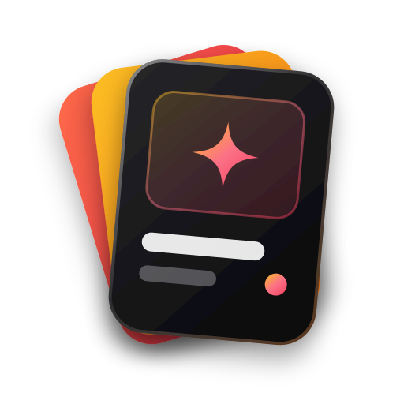
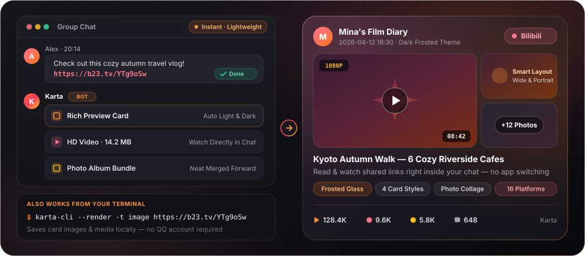

<div align="center">



# Karta

**Share a link in chat — get a beautiful preview card, photos, and video right back.**

A fast, lightweight social-media link preview bot for QQ (OneBot V11) and standalone CLI across **16 platforms**.

[](https://github.com/hua0512/karta/releases)
[](docs/deployment.md)
[](#supported-platforms)
[](https://hua0512.github.io/karta/)
[](LICENSE)

**English** · [简体中文](README.zh-CN.md) · [Documentation](https://hua0512.github.io/karta/) · [中文文档](https://hua0512.github.io/karta/zh/) · [Quick Start](#quick-start) · [Releases](https://github.com/hua0512/karta/releases)

<br />



</div>

## ✨ Highlights

- 🎨 **Frosted-Glass Cards** — Auto dark/paper themes, 4 card styles, smart photo collages, portrait video layouts & quoted reposts — drawn directly with **no heavy background browser**, running easily on a tiny VPS.
- 🌐 **Zero Account Hassle** — Recognizes URLs, bare `BV` IDs, Douyin share text (口令), and QQ mini-program cards; **14 of 16 platforms work without login**.
- 🎬 **Videos, Music & Tidy Albums** — Sends playable videos and extracted audio (`bm` / `ym`), and bundles multi-photo posts into **QQ merged-forwards** so galleries never flood the chat.
- 🛠️ **In-Chat Controls + CLI** — Scan a QR code in chat (`/login bilibili`), mute platforms or groups on the fly (`/disable`, `/karta off`), or save cards locally with `karta-cli`.

<a id="supported-platforms"></a>

## 🌐 Supported Platforms

| Category | Platforms | Highlights & Shortcuts |
| :--- | :--- | :--- |
| **Video & Live** | **Bilibili** · **Douyin (抖音)** · **YouTube** · **TikTok** · **Kuaishou (快手)** · **AcFun** · **WeChat Channels (视频号)** | Playable HD video, Bilibili episodes (`BV… 2`), audio-only (`bm BV…` / `ym <url>`), Douyin copy-paste share text (口令) |
| **Social & Notes** | **Twitter / X** · **Xiaohongshu (小红书)** · **Weibo (微博)** · **Instagram** | Multi-photo merged-forward albums, Reels & Stories, GIFs, quoted reposts |
| **Articles & Drama** | **WeChat Articles (公众号)** · **Hongguo (红果短剧)** | Formatted article cards with inline images, short dramas & motion comics (漫剧) |
| **Communities** | **NGA** · **Xiaoheihe (小黑盒)** · **V2EX** | Forum threads, featured replies & PC/console/mobile game cards |

> **14 platforms work out of the box.** Optional logins (`/login bilibili` QR, `xhs_cookie` for Xiaohongshu captchas, Yuanbao web cookie for WeChat Channels) are covered in **[docs/platforms.md](docs/platforms.md)**.

<a id="quick-start"></a>

## 🚀 Quick Start

Point `kovi.conf.toml` at your OneBot V11 client ([NapCat](https://github.com/NapNeko/NapCatQQ) / [Lagrange](https://github.com/LagrangeDev/Lagrange.Core) / [LLOneBot](https://github.com/LLOneBot/LLOneBot)) — or start interactively once to generate it — then launch with Docker (`ffmpeg`, fonts & logos included):

```yaml
# docker-compose.yml
services:
  karta:
    image: ghcr.io/hua0512/karta:latest
    restart: unless-stopped
    volumes:
      - ./kovi.conf.toml:/app/kovi.conf.toml
      - ./data:/app/data
```

```bash
# First time only (interactive wizard writes kovi.conf.toml):
mkdir -p data && touch kovi.conf.toml && docker compose run --rm karta
# Run in background:
docker compose up -d
```

- **Enable image cards:** set `"render_type": "image"` in `data/karta/config.json` (generated on first start) and restart.
- **Windows / Linux binaries:** grab `karta` & `karta-cli` from [**Releases**](https://github.com/hua0512/karta/releases) — see [Deployment](docs/deployment.md).
- **Terminal CLI (no QQ needed):** `karta-cli --render --render-type image "https://b23.tv/YTg9oSw"`

## 📚 Documentation

Full guides and an interactive **Visual Config Builder** at **<https://hua0512.github.io/karta/>** ([中文文档](https://hua0512.github.io/karta/zh/)):

| Guide | Contents |
| :--- | :--- |
| [Getting Started](docs/getting-started.md) | `kovi.conf.toml`, connecting NapCat / Lagrange / LLOneBot, first run |
| [Deployment](docs/deployment.md) | Docker Compose, `yt-dlp` setup, Windows/Linux binaries, building from source |
| [Configuration](docs/configuration.md) | Card themes & styles, media size limits, cookies, proxy settings |
| [Platforms](docs/platforms.md) | All 16 platforms, shortcuts (`bm`, `ym`), optional cookie setup |
| [Admin Commands](docs/commands.md) | `/status`, `/login bilibili`, `/karta on\|off`, `/disable`, `/ban` |
| [Development](docs/development.md) | Architecture, `karta-cli` options, testing & adding platforms |

## 📄 License

[MPL-2.0](LICENSE)
