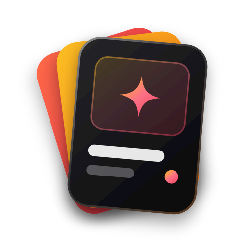
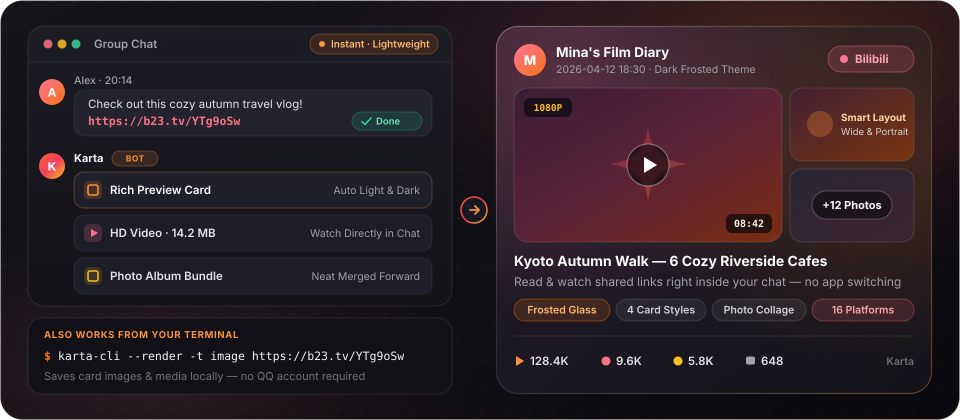

<div align="center">



# Karta

**往群里丢一条链接 —— 即刻返回高颜值预览卡片、原图合集与高清视频。**

轻快好用的多平台社媒链接解析 QQ 机器人（OneBot V11）与命令行工具，开箱支持 **16 大主流平台**。

[](https://github.com/hua0512/karta/releases)
[](docs/zh/deployment.md)
[](#supported-platforms)
[](https://hua0512.github.io/karta/zh/)
[](LICENSE)

[English](README.md) · **简体中文** · [中文文档](https://hua0512.github.io/karta/zh/) · [Documentation](https://hua0512.github.io/karta/) · [快速开始](#quick-start) · [版本下载](https://github.com/hua0512/karta/releases)

<br />



</div>

## ✨ 核心亮点

- 🎨 **高质感磨砂玻璃卡片** —— 自动切换深色磨砂与温润暖纸主题，内置 4 种卡片风格、多图智能拼图、竖屏视频分栏与转发预览；**无需常驻笨重的后台浏览器**，1 核轻量小鸡也能流畅运行。
- 🌐 **免登录即开即用** —— 自动识别链接、裸 `BV` 号、复制的**抖音分享口令**与 **QQ 小程序卡片**；**16 个平台中有 14 个零账号配置直接可用**。
- 🎬 **视频直发 · 多图不刷屏** —— 直接返回可播放视频与纯音乐（`bm` / `ym`），遇到小红书、微博等多图动态自动打包为整洁的**合并转发相册**。
- 🛠️ **聊天内扫码与群管 + CLI** —— 群内发送 `/login bilibili` 直接扫码登录并自动续期，随时按群或按平台开关（`/karta off`、`/disable 抖音`）；附带 `karta-cli` 支持终端本地出图。

<a id="supported-platforms"></a>

## 🌐 支持平台

| 类别 | 支持平台 | 特色与快捷玩法 |
| :--- | :--- | :--- |
| **视频与直播** | **Bilibili** · **抖音** · **YouTube** · **TikTok** · **快手** · **AcFun** · **微信视频号** | 高清视频直发、B 站选分 P（`BV… 2`）、仅提取纯音乐（`bm BV…` / `ym <链接>`）、抖音无链接口令 |
| **社交与图文** | **Twitter / X** · **小红书** · **微博** · **Instagram** | 多图无水印合并转发相册、Reels 与快拍、GIF、引用转发框 |
| **文章与短剧** | **微信公众号文章** · **红果短剧** | 带封面的图文排版卡片、短剧剧集与漫剧图集/视频 |
| **游戏与社区** | **NGA** · **小黑盒** · **V2EX** | 论坛主题帖、热门回复与 PC / 主机 / 手游商店详情卡 |

> **14 个平台开箱免登录。** 如需解锁 B 站高画质（`/login bilibili` 扫码）、规避小红书验证码或配置视频号（使用元宝网页版 Cookie，无需登录微信），详见 **[平台支持指南](docs/zh/platforms.md)**。

<a id="quick-start"></a>

## 🚀 快速开始

连接 [NapCat](https://github.com/NapNeko/NapCatQQ) / [Lagrange](https://github.com/LagrangeDev/Lagrange.Core) / [LLOneBot](https://github.com/LLOneBot/LLOneBot) 的正向 WebSocket，使用内置了 `ffmpeg`、字体与平台图标的官方镜像一键启动：

```yaml
# docker-compose.yml
services:
  karta:
    image: ghcr.io/hua0512/karta:latest
    restart: unless-stopped
    volumes:
      - ./kovi.conf.toml:/app/kovi.conf.toml
      - ./data:/app/data
```

```bash
# 首次运行（交互问答自动生成 kovi.conf.toml）：
mkdir -p data && touch kovi.conf.toml && docker compose run --rm karta
# 后台正式启动：
docker compose up -d
```

- **开启图片卡片：** 首次启动后打开 `data/karta/config.json`，将 `"render_type"` 改为 `"image"` 并重启。
- **Windows / Linux 安装包：** 前往 [**Releases**](https://github.com/hua0512/karta/releases) 下载单文件版 `karta` 与 `karta-cli`，详见[部署指南](docs/zh/deployment.md)。
- **仅在终端使用（无需 QQ）：** `karta-cli --render --render-type image "https://b23.tv/YTg9oSw"`

## 📚 在线文档

前往 **<https://hua0512.github.io/karta/zh/>**（[English Docs](https://hua0512.github.io/karta/)）体验**可视化配置生成器**与卡片风格预览：

| 文档 | 内容概览 |
| :--- | :--- |
| [快速开始](docs/zh/getting-started.md) | `kovi.conf.toml` 连接配置、首次启动指引 |
| [部署指南](docs/zh/deployment.md) | Docker Compose、`yt-dlp` 挂载、Windows/Linux 二进制、源码编译 |
| [配置参考](docs/zh/configuration.md) | 4 种卡片风格切换、视频体积上限、Cookie 与代理设置 |
| [平台支持](docs/zh/platforms.md) | 全部 16 个平台链接规则、快捷指令（`bm`、`ym`）与 Cookie 获取 |
| [管理命令](docs/zh/commands.md) | `/status`、`/login bilibili`、`/karta on\|off`、`/disable`、`/ban` |
| [开发指南](docs/zh/development.md) | 架构设计、`karta-cli` 参数与新增平台扩展 |

## 📄 开源许可

[MPL-2.0](LICENSE)
